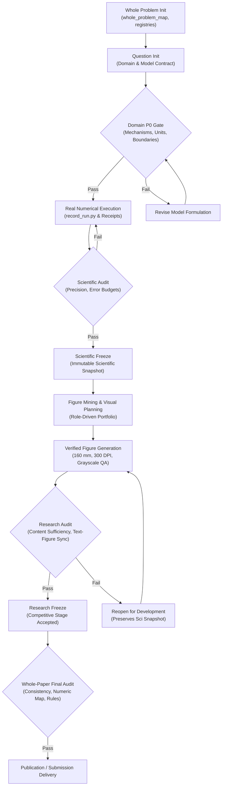

# ModelRigor

**Research-Grade Mathematical Modeling & Verified Scientific Computing**

[](https://github.com/2242756422-oss/modelrigor-math-modeling-skill/actions/workflows/ci.yml)
[](CHANGELOG.md)
[](LICENSE)
[](https://www.python.org/)

> *From mathematical reasoning to verified results and publication-grade scientific figures.*

[简体中文文档](README.zh-CN.md)

---

## Overview

Modern AI-assisted mathematical problem solving faces chronic failure modes:
- **Hallucinated numbers & fabricated metrics**: Models report benchmark victories or parameter estimates without executing reproducible code.
- **Premature algorithmic complexity**: Black-box algorithms are applied before physical governing relations, boundary conditions, or dimensional units are established.
- **Unverifiable claims**: Academic claims in draft manuscripts point to missing, modified, or out-of-date calculation runs.
- **Cosmetic visualizations**: Charts are generated without colorblind-safe palettes, physical publication dimensions, grayscale contrast, or underlying data bindings.

**ModelRigor** (`modelrigor`) is a production-grade Agent Skill and CLI toolchain designed for rigorous mathematical modeling, reproducible scientific computing, and academic manuscript development. Built over dozens of development iterations, it enforces **fail-closed verification gates**, **cryptographic result provenance**, **dual-freeze state machines**, and **publication-standard visualization standards**.

---

## Core Differentiators

| Capability | Generic AI Problem Solving | ModelRigor System |
| :--- | :--- | :--- |
| **Problem Formulation** | Jumps directly to standard algorithms | Problem-first mechanism derivation; Domain P0 gate |
| **Numerical Integrity** | Unchecked prose numbers | SHA-256 execution receipts binding argv, inputs, and outputs |
| **State Management** | Single flat review or unverified draft | Dual Freeze: Scientific Freeze separated from Research Freeze |
| **Error & Sensitivity** | Ignored or simulated | Order-of-accuracy checks, mass conservation, identifiability |
| **Scientific Figures** | Arbitrary decorative charts | Role-driven candidates, 160 mm publication sizing, DPI & grayscale QA |
| **Cross-Question Coupling**| Disconnected question answers | Dependency graphs with automatic downstream `STALE` invalidation |
| **Execution Overhead** | Bloated administrative ledgers | Adaptive `HIGH_QUALITY_EFFICIENT` profile (6 staged artifacts) |

---

## Architecture

ModelRigor operates via a modular architecture connecting declarative policies, schemas, command-line runners, and domain protocols:

```
modelrigor/
├── SKILL.md                          # Primary agent entry point and protocol routing
├── policy.json                       # Canonical state machine, rules, and quality dimensions
├── CHANGELOG.md                      # Version lineage and detailed release history
├── LICENSE                           # MIT open-source license
├── agents/
│   └── openai.yaml                   # Agent metadata and invocation interface
├── scripts/
│   ├── cqex.py                       # CLI orchestrator (init, audit, freeze, reopen, impact)
│   ├── core.py                       # Fail-closed evidence, receipt, and audit engine
│   ├── record_run.py                 # Reproducible execution runner with SHA-256 receipts
│   ├── register_result.py            # Typed locator result registration
│   ├── provenance.py                 # Source categorization and cryptographic verification
│   ├── check_skill_integrity.py      # Package and regression integrity auditor
│   ├── mine_visual_opportunities.py  # Model-driven figure candidate mining
│   └── visual_resource_smoke.py      # Plotting smoke tester with native Matplotlib fallback
├── references/                       # Progressive disclosure protocols
│   ├── domain_and_model_protocol.md  # Mechanism-to-equation modeling guidelines
│   ├── scientific_evidence_protocol.md# Receipt standards and claim-evidence mappings
│   ├── visual_research_engine.md     # Figure candidate roles and layout QA
│   ├── scientific_visualization_cookbook.md # Publication styling and palettes
│   ├── key_decision_only_protocol.md # Compact decision-packet collaboration
│   └── whole_paper_audit.md          # Multi-question final manuscript audit
├── schemas/                          # JSON schemas for templates and receipts
├── templates/                        # Reusable declarative modeling artifacts
├── examples/                         # Verified numerical and plotting demonstrations
└── tests/                            # Test suite (100 pytest cases + adversarial probes)
```

### Lifecycle & Verification Workflow



---

## Operating Modes

1. **`FULL_RESEARCH`**: Complete end-to-end pipeline covering domain modeling, solver execution, targeted sensitivity analysis, publication figures, and full manuscript development.
2. **`KEY_DECISION_ONLY`**: Emits a compact, executable `QUESTION_DECISION_PACKET.md` and pauses before expensive computation, allowing external solvers or human experimenters to execute the work.
3. **`RETURN_AUDIT`**: Performs targeted spot-checks and verification on external execution returns (`EXECUTION_RETURN.md`) before admitting results into the formal registry.

---

## Requirements & Environments

- **Python**: 3.10 or higher (tested on 3.10, 3.11, 3.12, 3.13)
- **Core Dependencies**:
  ```bash
  pip install pytest numpy matplotlib pillow
  ```
- **Supported Platforms**: macOS, Linux, Windows
- **Agent Environments**: Compatible with Codex Skills, Claude Code, Antigravity, OpenHands, and local command-line usage.

---

## Installation

### Method 1: Install as a Codex Skill (Direct Clone)

Clone directly into your Codex skills directory:

```bash
git clone https://github.com/2242756422-oss/modelrigor-math-modeling-skill.git ~/.codex/skills/modelrigor
```

### Method 2: Standalone Repository Usage

```bash
git clone https://github.com/2242756422-oss/modelrigor-math-modeling-skill.git
cd modelrigor-math-modeling-skill
pip install -r <(echo -e "pytest\nnumpy\nmatplotlib\npillow")
```

### Verify Installation & Package Integrity

Run the built-in integrity auditor:

```bash
python scripts/check_skill_integrity.py . --scope package
```

Run the unit test suite:

```bash
pytest tests/
```

Both commands should exit with code 0 (`OVERALL PACKAGE INTEGRITY PASS`, `100 passed`).

---

## Quick-Start Tutorial

### Step 1: Initialize Whole-Problem Workspace

Initialize a multi-question project workspace:

```bash
python scripts/cqex.py init-project ./my_project --id math_opt_2026
```

This creates project-level registries (`project_state.json`, `whole_problem_map.json`, `page_budget.json`, `symbol_registry.json`, `figure_portfolio.csv`).

### Step 2: Initialize Question Module

Initialize the first sub-problem (`q1`) with the modern efficient profile:

```bash
python scripts/cqex.py init-question ./my_project/q1 --id q1 --profile HIGH_QUALITY_EFFICIENT
```

### Step 3: Configure Domain Knowledge (Domain P0 Gate)

Activate specific domain checks for the question (e.g., physical dynamical systems or continuous optimization):

```bash
python scripts/cqex.py activate-domain ./my_project/q1 physical optimization
```

Fill in `domain_model_map.json` and `model_contract.json` with actual governing equations, units, state/decision variables, and boundary conditions.

### Step 4: Execute Solver with Execution Receipts

Run your solver script using `record_run.py` to capture cryptographic execution receipts:

```bash
python scripts/record_run.py \
  --root ./my_project/q1 \
  --code ./solvers/rk4_solver.py \
  --input ./data/params.json \
  --output ./results/output.json \
  --receipt ./results/receipt.json \
  -- python ./solvers/rk4_solver.py ./data/params.json ./results/output.json
```

Register key numerical results into the result registry:

```bash
python scripts/register_result.py ./my_project/q1 \
  --id R1 \
  --meaning "steady_state_concentration" \
  --unit "mg/L" \
  --source-type computed \
  --artifact "results/output.json" \
  --pointer "/endpoint" \
  --scientific-version 1
```

### Step 5: Freeze Scientific Snapshot

Audit and freeze the scientific snapshot:

```bash
python scripts/cqex.py audit-question ./my_project/q1 --phase scientific
python scripts/cqex.py freeze-scientific ./my_project/q1
```

Scientific Freeze creates an immutable record in `scientific_manifest.json`. Downstream questions dependent on `q1` will be notified of version updates.

### Step 6: Visual Planning & Research Freeze

Prepare the development stage artifacts:

```bash
python scripts/cqex.py prepare-stage ./my_project/q1 develop
```

Generate verified figures using the publication styling guidelines, inspect them, audit, and freeze the research milestone:

```bash
python scripts/cqex.py audit-question ./my_project/q1 --phase research
python scripts/cqex.py freeze-research ./my_project/q1
```

---

## Reproducible Examples

The repository includes standalone, mathematically rigorous examples in [`examples/`](examples/):

### 1. Controlled ODE Convergence Verification (`linear_decay_validation.py`)
Computes first-order decay $\frac{dC}{dt} = -kC$ with exact analytic comparison across 4 refinement grid sizes:

```bash
python examples/linear_decay_validation.py solve /tmp/demo_ode
python examples/linear_decay_validation.py verify /tmp/demo_ode
python examples/linear_decay_plot.py /tmp/demo_ode
```
- **Output**: Demonstrates 4th-order Runge-Kutta asymptotic error convergence ($\sim 4.0$ refinement order) and exact error bounds ($1.22 \times 10^{-9}$).
- Generates 160 mm publication SVG and PNG figures.

### 2. Conservative Dynamical Exchange (`conservative_exchange.py`)
Simulates a two-compartment conservation model $V \frac{dc}{dt} = (-Q(c_1-c_2), Q(c_1-c_2))$:

```bash
python examples/conservative_exchange.py --out /tmp/demo_exchange.json
python examples/conservative_exchange_plot.py /tmp/demo_exchange.json --out /tmp/demo_plots
```
- **Output**: Verifies analytical mass invariance ($|\Delta M| < 10^{-15}$), tests explicit vs. implicit positivity preservation, and performs parameter identifiability checks.

---

## Verification Gates Explained

ModelRigor establishes four non-negotiable verification gates:

1. **Domain P0 Gate**:
   Physical or mathematical mechanisms must explicitly enter governing equations, boundary conditions, variable definitions, and failure modes before production solving begins.
2. **Scientific Freeze Gate**:
   Requires valid mathematical closure, explicit assumption tracking, exact pointer-to-artifact bindings, and dominant risk validation. Once frozen, changing code or inputs marks downstream dependencies `STALE`.
3. **Research Freeze Gate**:
   Evaluates substantive content development, table/figure portfolio completeness, and numerical alignment between text and results. If writing needs further expansion, `reopen-development` reopens presentation while preserving the scientific snapshot.
4. **Whole-Paper Final Audit**:
   Executes `audit-paper` to verify global symbol consistency, figure numbering, official contest rule compliance (pages, format, anonymity), and complete numeric synchronization via `sync_paper_numeric_map.py`.

---

## Limitations & Boundaries

- **Not an Automated Math Prover**: ModelRigor enforces structural completeness, receipt validity, error tolerances, and test execution. It does NOT automatically replace human mathematical review for novel theoretical proofs.
- **No Guaranteed Contest Prizes or Journal Acceptances**: ModelRigor provides research-grade scaffolding, discipline, and verification; final academic merit rests with the authors' intellectual contributions.
- **External Specialized Tooling**: Complex Word/PDF page-rendering QA (`--scope full`) requires local Word/PDF rendering binaries; package-level integrity (`--scope package`) verifies all scripts, schemas, and regressions natively.

---

## Contributing

Contributions are welcome. Please ensure:
1. All changes preserve fail-closed evidence guarantees.
2. `pytest tests/` passes completely (100% test pass rate).
3. `python scripts/check_skill_integrity.py . --scope package` passes without regression.
4. No hardcoded absolute local paths are committed.

Submit issues and pull requests via GitHub.

---

## License & Attribution

This project is open-source under the [MIT License](LICENSE).

Copyright (c) 2026 ModelRigor Contributors (`2242756422-oss`).
