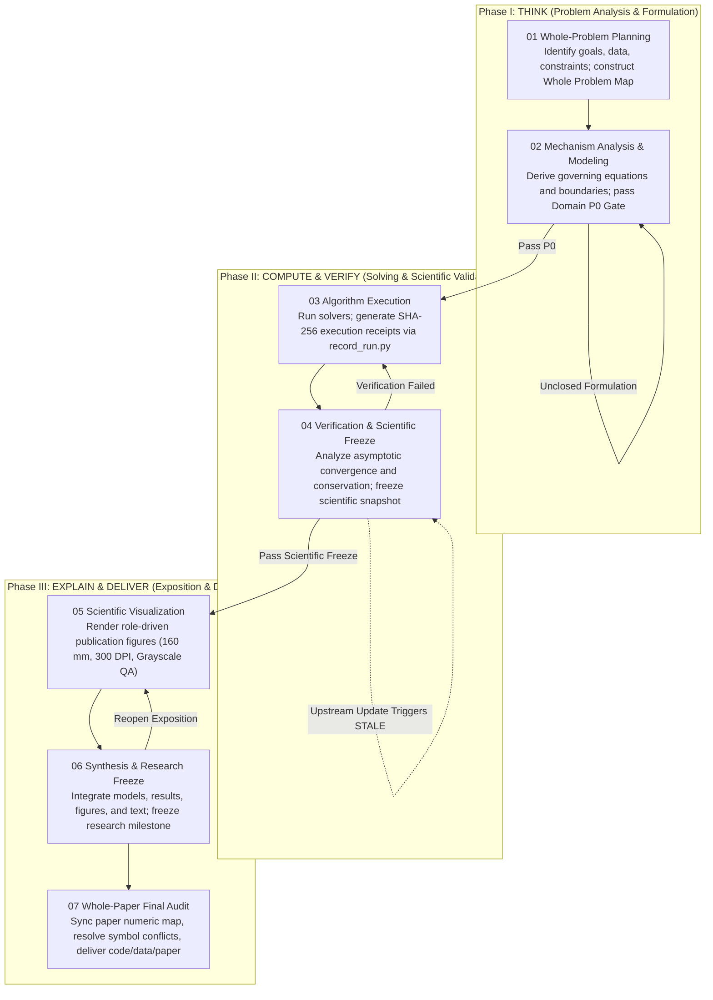

# ModelRigor

**Research-Grade Mathematical Modeling · Verified Scientific Computing · Academic Visualization**

[](https://github.com/2242756422-oss/modelrigor-math-modeling-skill/actions/workflows/ci.yml)
[](CHANGELOG.md)
[](LICENSE)
[](https://www.python.org/)

> **Ground mathematical modeling in fundamental mechanisms; anchor computational results in cryptographic evidence; trace scientific conclusions to verifiable sources.**  
> Transform problem analysis, rigorous derivations, numerical computation, error verification, publication-grade figures, and academic reporting into an executable research closed loop.

[简体中文文档](README.zh-CN.md)

---

## Table of Contents

- [1. Positioning & Philosophy](#1-positioning--philosophy)
- [2. Six Core Differentiators](#2-six-core-differentiators)
- [3. Three-Minute Quick Start](#3-three-minute-quick-start)
- [4. Three Practical Scenarios](#4-three-practical-scenarios)
- [5. Collaboration Modes](#5-collaboration-modes)
- [6. Seven-Stage Research Workflow](#6-seven-stage-research-workflow)
- [7. Dual-Freeze Architecture: Scientific Layer vs. Research Layer](#7-dual-freeze-architecture-scientific-layer-vs-research-layer)
- [8. Fully Reproducible Built-in Examples](#8-fully-reproducible-built-in-examples)
- [9. Advanced CLI Command Guide](#9-advanced-cli-command-guide)
- [10. Frequently Asked Questions (FAQ)](#10-frequently-asked-questions-faq)
- [11. Technical Boundaries & Limitations](#11-technical-boundaries--limitations)
- [12. Contributing & License](#12-contributing--license)

---

## 1. Positioning & Philosophy

Modern AI assistants applied to mathematical modeling and scientific computing exhibit four chronic failure modes:
1. **Mechanism Disconnect & Algorithm Stacking**: Jumping directly into complex black-box machine learning or meta-heuristic algorithms before clarifying governing physics, dimensional units, constraints, and boundary conditions.
2. **Hallucinated Numbers & Fabricated Metrics**: Quoting parameter estimates, convergence rates, or benchmark victories that were never computed by executable code.
3. **Unverifiable Paper Claims**: Numerical findings in draft manuscripts cannot be mapped back to a specific run version, parameter configuration, or output artifact.
4. **Cosmetic Visualizations**: Charts generated with arbitrary dimensions, lacking DPI verification, ignoring grayscale readability, and disconnected from underlying data.

**ModelRigor** (`modelrigor`) is an open-source Agent Skill and CLI toolchain designed for rigorous mathematical modeling, reproducible scientific computing, and academic manuscript development. Built over dozens of iterative hardening cycles, it connects domain derivation, solver execution, error analysis, publication figures, and whole-paper audit into an **executable, auditable, and traceable** research pipeline.

> **Guiding Principle**: Complexity is not the objective; explaining the phenomenon, solving the problem, and withstanding empirical inspection is the objective. Not just asking AI to generate answers, but ensuring every modeling step is justified, every number is evidenced, and every conclusion is verifiable.

---

## 2. Six Core Differentiators

### 1. Mechanism-First, Not Algorithm Stacking
ModelRigor rejects the blind application of fashionable algorithms. The system requires researchers to first understand the physical, statistical, or geometric mechanisms of the problem, formalize governing equations and constraints, and only then select an appropriate numerical or analytical solver.
- **Domain P0 Gate**: Production solving is strictly blocked until governing relations, boundary conditions, and failure modes are closed.
- **Model Contract**: Explicitly binds domain entities to equation formulations and evaluator inputs/outputs.
- **Problem-Driven Solver Selection**: Prioritizes analytical, asymptotic, or structured routes first; reserves deep algorithmic innovation for genuine baseline shortcomings.

### 2. Real Computation, Never Fabricated Results
ModelRigor enforces a fail-closed separation between natural language generation and true numerical code execution.
- **Cryptographic SHA-256 Execution Receipts**: `record_run.py` captures cryptographic hashes of the solver source code, inputs, outputs, and process exit facts.
- **Typed Provenance Categorization**: Strictly distinguishes between `COMPUTED` (production execution), `ANALYTICAL` (mathematical derivation), `OBSERVED` (empirical measurement), `GIVEN` (contest statement), and `DEMO` (quarantined illustration).
- **Separation of Errors**: Distinguishes numerical discretization error from manuscript display rounding.

### 3. Dual-Freeze Scientific Architecture
One of ModelRigor's signature design principles is the complete decoupling between the **Scientific Layer** and the **Research Layer**:
- **Scientific Freeze**: Locks verified mathematical models, input parameters, solver code, and numerical results into an immutable snapshot (`scientific_manifest.json`).
- **Research Freeze**: Independently evaluates manuscript depth, table/figure portfolios, and exposition quality.
- **Practical Benefit**: Polishing manuscript prose or adjusting figure palettes never forces unnecessary re-computation of verified numerical experiments.

### 4. Whole-Problem Orchestration, Not Fragmented Q&A
Mathematical contests and research projects consist of interconnected questions. ModelRigor maintains cross-question consistency and prevents parameter or symbol contradictions.
- **Whole Problem Map**: Manages global invariants, shared parameters, and symbol registries across sub-problems.
- **Cascading `STALE` Invalidation**: If an upstream question (e.g., q1) changes its core model and updates its version, all dependent downstream questions (q2, q3) are automatically flagged as `STALE`.
- **Numeric Map Synchronization (`sync_paper_numeric_map.py`)**: Cryptographically verifies that every key numerical token in the paper text resolves to an approved Result Registry entry.

### 5. Scientific Visualizations as Empirical Evidence, Not Decoration
Visualizations in ModelRigor are substantive empirical proof, planned during model construction to address explicit scientific questions.
- **Role-Driven Figure Mining (Figure Roles)**: Supports mechanism diagrams (`MECHANISM`), convergence plots (`CONVERGENCE`), objective landscapes (`LANDSCAPE`), sensitivity heatmaps (`SENSITIVITY`), and uncertainty bands (`UNCERTAINTY`).
- **Publication Standards**: Enforces standard physical widths (e.g., 160 mm full-page / 80 mm column), 300 DPI effective raster sampling, Okabe-Ito colorblind-safe palettes, and grayscale contrast validation.
- **Zero-Data Visuals Rejected**: Every figure must bind to a registered result ID and input hash; blank or decorative placeholder images are rejected.

### 6. End-to-End Closed-Loop Research Workflow
ModelRigor is a complete, executable engineering toolchain:
- **Agent Skill Domain Protocols**: Guides language models to behave with scientific rigor.
- **Python CLI Toolchain**: Clean commands for workspace setup, execution wrapping, and gate verification.
- **JSON Schemas**: Fail-closed structural validation for contracts, budgets, and receipts.
- **Automated Regression Suite**: 100 pytest test cases and 39 adversarial bypass probes ensure zero architectural regressions.

---

## 3. Three-Minute Quick Start

ModelRigor is an Agent Skill designed for Codex and compatible environments. **Beginners do not need to manually configure JSON files**—simply communicate naturally with the agent.

### Step 1: Clone the Skill Repository
Clone directly into your Codex skills directory:
```bash
git clone https://github.com/2242756422-oss/modelrigor-math-modeling-skill.git ~/.codex/skills/modelrigor
```

### Step 2: Install Python Dependencies
```bash
pip install -r ~/.codex/skills/modelrigor/requirements.txt
```

### Step 3: Invoke the Skill in Codex
In your Codex chat window, invoke the skill:
```text
$modelrigor
Please solve the mathematical modeling problem I have uploaded (e.g. CUMCM Problem A) using FULL_RESEARCH mode:
1. Deconstruct the entire problem and output a Whole Problem Map;
2. Perform mechanism analysis for Question 1, define governing equations and boundary conditions, pass Domain P0 audit, and execute numerical solving;
3. Generate publication-grade figures with convergence and error analyses.
```
The agent will automatically follow ModelRigor's phased protocols and verification gates.

---

## 4. Three Practical Scenarios

```
                                  ┌───────────────────────────┐
                                  │   User Research Objective │
                                  └─────────────┬─────────────┘
                                                │
                 ┌──────────────────────────────┼──────────────────────────────┐
                 │                              │                              │
                 ▼                              ▼                              ▼
      [ Scenario A: Contest ]         [ Scenario B: Solver Only ]     [ Scenario C: Audit ]
      • Mode: FULL_RESEARCH           • Mode: KEY_DECISION_ONLY       • Mode: RETURN_AUDIT / audit-paper
      • Whole-problem deconstruction  • Focus on governing mechanisms • Cryptographic evidence audit
      • Multi-question real solving   • Order-of-accuracy checks      • Reverse paper-to-result mapping
      • Publication figures (160 mm)  • Identifiability & error bounds • Strict AUDIT ONLY (no file edits)
      • Whole-paper consistency audit • No paper drafting required    • Objective discrepancy report
```

### Scenario A: Full Mathematical Contest Pipeline (CUMCM / MCM / ICM)
- **Use Case**: A student team participating in a contest requiring full-problem deconstruction, multi-question modeling, computation, and paper delivery.
- **Workflow**: Invokes `FULL_RESEARCH`. The agent creates global registries, steps through each question, enforces `Scientific Freeze` upon numerical completion, generates publication figures, drafts the paper, and runs `audit-paper` to verify rule and numeric compliance.

### Scenario B: Mathematical Modeling & Algorithm Solver Only
- **Use Case**: Engineering or academic research requiring verified equations, solvers, and sensitivity analyses without drafting a full manuscript.
- **Workflow**: Instructs the agent to stop after `Scientific Freeze`. ModelRigor initializes only the 6 core modeling artifacts, solves the system with execution receipts, verifies convergence orders, and stops.

### Scenario C: Independent Research Audit
- **Use Case**: Auditing an existing modeling paper or colleague's draft for mathematical closure, numerical authenticity, and figure consistency.
- **Workflow**: Specifies `AUDIT ONLY, do not modify original files`. ModelRigor verifies inputs against outputs, inspects receipt hashes, checks whether numbers in the text match approved results, and outputs an objective defect report.

---

## 5. Collaboration Modes

| Collaboration Mode | Typical Use Case | Core Mechanism | Quality Gates Enforced |
| :--- | :--- | :--- | :--- |
| **`FULL_RESEARCH`**<br/>(Autonomous Pipeline) | Standard compute tasks managed end-to-end by the agent | Executes domain derivation, code solving, error checks, figure plotting, and final paper audit | Domain P0, Scientific Freeze, Research Freeze, Whole-Paper Final Audit |
| **`KEY_DECISION_ONLY`**<br/>(Decision Packet) | Heavy computation (e.g., large FEM, distributed RL) or external clusters | Stage A: Agent emits an executable `QUESTION_DECISION_PACKET.md` and pauses before expensive computation | Does not falsely claim Freeze at pause; preserves decision integrity |
| **`RETURN_AUDIT`**<br/>(External Return Audit) | Ingesting solver results returned from external computing clusters | Stage B: Performs 1–3 representative spot-checks (conservation laws, residuals, bounds) on `EXECUTION_RETURN.md` | Spot-checks must pass before admitting results into formal registries |

---

## 6. Seven-Stage Research Workflow

ModelRigor structures modeling into seven sequential stages:




---

## 7. Dual-Freeze Architecture: Scientific Layer vs. Research Layer

ModelRigor prevents the coupling of manuscript writing with scientific experiments:

```
┌────────────────────────────────────────────────────────────────────────┐
│                        Research Layer (Exposition)                     │
│                                                                        │
│   • Manuscript narrative and content sufficiency                       │
│   • Multi-role publication figures (160 mm, 300 DPI, Grayscale QA)     │
│   • Table portfolio and information formatting                         │
│   • Global symbol registries and equation numbering                    │
│   • Paper numeric map synchronization and whole-paper audit            │
│                                                                        │
│   Gate: Research Freeze                                                │
│   Feature: reopen-development reopens writing without solver reruns    │
└───────────────────────────────────▲────────────────────────────────────┘
                                    │ Cryptographic Hash Binding
┌───────────────────────────────────┴────────────────────────────────────┐
│                       Scientific Layer (Truth & Evidence)              │
│                                                                        │
│   • Domain mechanisms and governing equations (Domain P0 Gate)         │
│   • Explicit assumption ledger and operational bounds                  │
│   • Reproducible code execution and SHA-256 receipts                   │
│   • Typed result registration (COMPUTED, ANALYTICAL, OBSERVED, GIVEN)  │
│   • Order-of-accuracy, conservation, and sensitivity validation        │
│                                                                        │
│   Gate: Scientific Freeze                                              │
│   Feature: Generates immutable manifest; propagates STALE downstream   │
└────────────────────────────────────────────────────────────────────────┘
```

---

## 8. Fully Reproducible Built-in Examples

The repository includes two self-contained mathematical modeling demonstrations in [`examples/`](examples/):

### Example 1: 4th-Order Runge-Kutta Asymptotic Convergence Verification
- **Model**: First-order decay $\frac{dC}{dt} = -kC$ with exact analytical solution $C(t) = e^{-0.5t}$.
- **Objective**: Solve across 4 successively halved grid steps, verify 4th-order convergence rates, and export a 160 mm publication figure.
```bash
python examples/linear_decay_validation.py solve /tmp/ode_study
python examples/linear_decay_validation.py verify /tmp/ode_study
python examples/linear_decay_plot.py /tmp/ode_study
# Output: Refinement orders [4.15, 4.07, 4.03]; Maximum grid error 1.22e-9
```

### Example 2: Conservative Two-Compartment Dynamical Exchange
- **Model**: Linear exchange system $V \frac{dc}{dt} = (-Q(c_1-c_2), Q(c_1-c_2))$.
- **Objective**: Verify analytical mass invariance down to machine precision ($|\Delta M| < 10^{-15}$), demonstrate unconditional positivity preservation of implicit Euler, and check flow rate parameter identifiability.
```bash
python examples/conservative_exchange.py --out /tmp/exchange_study.json
python examples/conservative_exchange_plot.py /tmp/exchange_study.json --out /tmp/exchange_plots
```

---

## 9. Advanced CLI Command Guide

For users operating directly in the terminal:

```bash
# 1. Initialize whole-problem workspace
python scripts/cqex.py init-project ./my_project --id math_opt_2026

# 2. Initialize question directory (HIGH_QUALITY_EFFICIENT profile)
python scripts/cqex.py init-question ./my_project/q1 --id q1

# 3. Activate specialist domain checks
python scripts/cqex.py activate-domain ./my_project/q1 physical optimization

# 4. Execute solver script with SHA-256 receipt tracking
python scripts/record_run.py \
  --root ./my_project/q1 \
  --code ./solvers/solve.py \
  --input ./data/params.json \
  --output ./results/out.json \
  --receipt ./results/receipt.json \
  -- python ./solvers/solve.py ./data/params.json ./results/out.json

# 5. Register critical numerical result
python scripts/register_result.py ./my_project/q1 \
  --id R1 --meaning "optimal_value" --unit "dimensionless" \
  --source-type computed --artifact "results/out.json" --pointer "/best_f" --scientific-version 1

# 6. Audit and freeze scientific snapshot
python scripts/cqex.py audit-question ./my_project/q1 --phase scientific
python scripts/cqex.py freeze-scientific ./my_project/q1

# 7. Audit and freeze research milestone
python scripts/cqex.py prepare-stage ./my_project/q1 develop
python scripts/cqex.py audit-question ./my_project/q1 --phase research
python scripts/cqex.py freeze-research ./my_project/q1

# 8. Reopen writing without touching verified scientific computations
python scripts/cqex.py reopen-development ./my_project/q1

# 9. Analyze impact of modified solver code
python scripts/cqex.py impact ./my_project/q1 solvers/solve.py --apply

# 10. Multi-question whole-paper audit
python scripts/cqex.py audit-paper ./my_project/whole_paper_audit.json
```

---

## 10. Frequently Asked Questions (FAQ)

### Q1: Why does the Scientific Audit block progress?
> **Answer**: ModelRigor is a **fail-closed** system. If equations lack boundary conditions, assumptions are unstated, or registered results fail JSON Pointer resolution against SHA-256 output hashes, the audit halts execution. This prevents downstream work on defective models.

### Q2: Can I edit manuscript text without re-running heavy computations?
> **Answer**: **Yes, completely.** Run `python scripts/cqex.py reopen-development <question_dir>`. This changes the research status to `REOPEN_FOR_DEVELOPMENT` while **leaving the frozen scientific snapshot and execution receipts untouched**. Once writing edits are complete, simply run `freeze-research`.

### Q3: What is the `STALE` status and how should I handle it?
> **Answer**: If Question 2 depends on parameters from Question 1, updating Question 1's scientific version will automatically mark Question 2 as `STALE`. Review Question 1's updated values, re-evaluate their impact on Question 2, and re-freeze.

### Q4: How do I resolve missing dependencies?
> **Answer**: Install the required libraries via `pip install -r requirements.txt`. If an external plotting library is missing, ModelRigor **automatically falls back to native Matplotlib** without halting.

---

## 11. Technical Boundaries & Limitations

To maintain scientific integrity, ModelRigor clearly defines its boundaries:
1. **Not an Automated Theorem Prover**: ModelRigor verifies structural closure, execution facts, discretization convergence, and numeric consistency; it does **not** substitute for human intellectual rigor in novel theoretical proofs.
2. **No Guaranteed Contest Awards or Journal Acceptance**: The framework provides research discipline and anti-hallucination gates; ultimate academic merit depends on the researchers' intellectual contributions.
3. **Test Scope Context**: The 100 passing automated unit tests verify software functionality and safety mechanisms; they do not imply that arbitrary real-world problems can be solved automatically.

---

## 12. Contributing & License

### Running Integrity Audits & Test Suites
```bash
# 1. Run unit test suite (100 tests)
pytest tests/

# 2. Run package integrity audit
python scripts/check_skill_integrity.py . --scope package
```

### Open-Source License
ModelRigor is licensed under the [MIT License](LICENSE).  
Copyright (c) 2026 ModelRigor Contributors (`2242756422-oss`).
