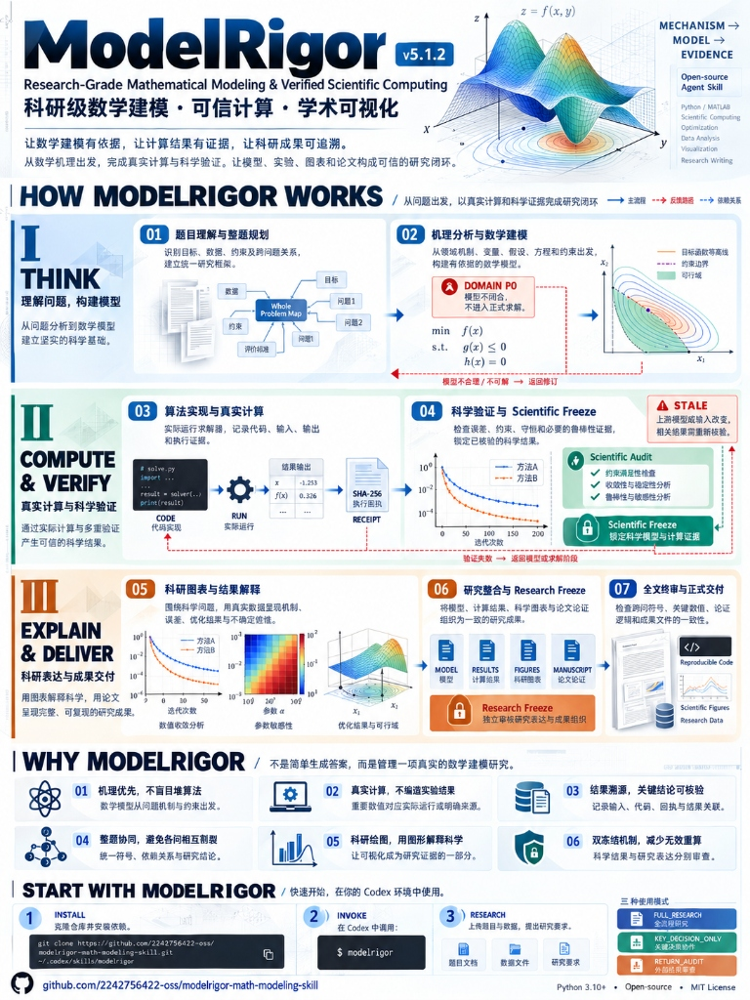
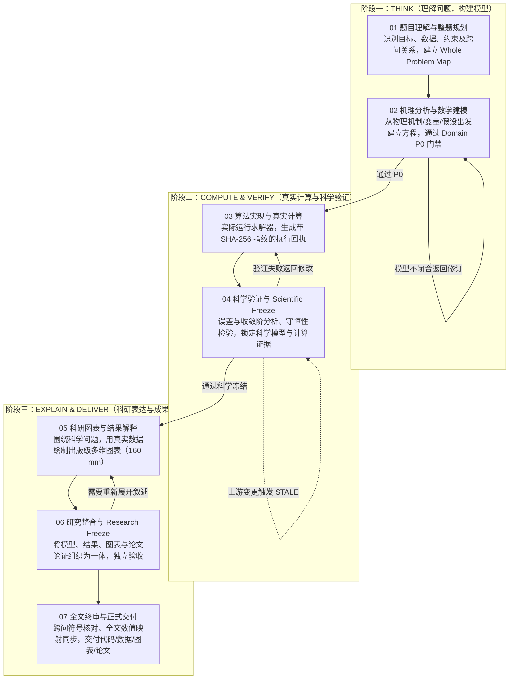

# ModelRigor

**科研级数学建模 · 可信计算 · 学术可视化**  
*Research-Grade Mathematical Modeling & Verified Scientific Computing*

[](https://github.com/2242756422-oss/modelrigor-math-modeling-skill/actions/workflows/ci.yml)
[](CHANGELOG.md)
[](LICENSE)
[](https://www.python.org/)

> **让数学建模有依据，让计算结果有证据，让科研成果可追溯。**  
> 从数学机理出发，完成真实计算与科学验证，让模型、实验、图表和论文构成可信的研究闭环。

[English Documentation](README.md)

---

## 目录

- [一、项目定位与核心理念](#一项目定位与核心理念)
- [二、六大核心特色](#二六大核心特色)
- [三、三分钟极速上手](#三三分钟极速上手)
- [四、三大典型使用场景](#四大典型使用场景)
- [五、三种科研协作模式](#五三种科研协作模式)
- [六、七阶段科研工作流](#六七阶段科研工作流)
- [七、双冻结科研架构：科学可信层与研究表达层](#七双冻结科研架构科学可信层与研究表达层)
- [八、可完全复现的内置实验样例](#八可完全复现的内置实验样例)
- [九、高级 CLI 指令指南](#九高级-cli-指令指南)
- [十、常见问题与深度解答（FAQ）](#十常见问题与深度解答faq)
- [十一、客观能力边界声明](#十一客观能力边界声明)
- [十二、参与贡献与开源协议](#十二参与贡献与开源协议)

---

## 一、项目定位与核心理念

在当前生成式 AI 辅助数学建模与科研计算的实践中，普遍存在四大核心失效：
1. **机理脱节与算法盲目堆叠**：在尚未厘清物理守恒、几何拓扑、量纲单位与边界条件前，盲目套用复杂的黑盒机器学习或元启发式算法。
2. **数值虚构与幻觉指标**：直接在论文中写出未经代码真实运行的参数值、收敛阶或基线比较结果。
3. **主张与证据不可追溯**：论文正文中的核心数值无法对应到具体的运行版本、输入参数哈希与输出工件。
4. **图表装饰化与粗制滥造**：图表缺乏科研信息承载力，尺寸比例任意、无有效 DPI 校验、无灰度对比度检查、无真实数据绑定。

**ModelRigor** (`modelrigor`) 是一套面向复杂数学建模与科研计算的开源 Agent Skill。它将问题分析、数学机理推导、模型与算法设计、实际数值计算、科学验证、科研可视化和论文交付连接成一套**可执行、可检查、可追溯**的研究工作流。

> **核心原则**：复杂不是目的，能够解释问题、解决问题并经受检验才是目的。不只是让 AI 生成建模答案，而是让建模过程有依据、计算结果有证据、科学结论经得起检查。

---

## 二、六大核心特色

### 1. 机理优先，而非算法堆叠
ModelRigor 坚决反对直接把热门算法模板套入题目。系统首先要求研究者理解问题的物理机制、统计结构或决策逻辑，明确状态/决策变量、量纲、假设条件与失效边界，再构建有依据的数学模型。
- **Domain P0 门禁**：领域机理与边界未明确前，禁止进入生产求解。
- **模型契约（Model Contract）**：将领域对象与控制方程、评估器输入输出显式绑定。
- **问题驱动的算法选择**：解析/结构化路线优先，成熟模型足够时不盲目堆叠黑盒；确有研究缺口时，从机理、约束或结构分解形成实质创新。

### 2. 真实计算，不靠虚构结果
ModelRigor 将自然语言生成与真实的数值代码运行彻底隔离。所有关键数值必须来自真实执行并记录证据。
- **密码级 SHA-256 执行回执**：通过 `record_run.py` 记录执行代码哈希、输入哈希、输出哈希及进程退出事实。
- **精细来源性质分类（Provenance Category）**：明确区分 `COMPUTED`（真实生产运行）、`ANALYTICAL`（推导与理论解）、`OBSERVED`（真实测量观测）、`GIVEN`（赛题已知给定）与 `DEMO`（受限演示），杜绝用口头声明或形式化 PASS 充当运行证据。
- **数值容差分离**：计算误差（机器精度与离散截断）与正文显示舍入严格分离，禁止用大容忍度掩盖算术错误。

### 3. 科学结果与研究表达，分开管理（双冻结体系）
这是 ModelRigor 最具特色的软件架构设计：**将数学真值层（Scientific Layer）与成果写作层（Research Layer）分离**。
- **Scientific Freeze（科学冻结）**：锁定已经完成推导闭合、数值求解、误差检验与主风险分析的科学快照（生成不可篡改的 `scientific_manifest.json`）。
- **Research Freeze（成果冻结）**：针对论文叙述深度、图表角色覆盖率与成果组织进行独立验收。
- **解耦价值**：修饰论文措辞、调整图注排版，无需无谓重跑耗时实验；若修改了控制方程或输入参数，系统将精准定向使受影响结果失效。

### 4. 不是逐问拼接，而是整题协同
数学建模通常由多个环环相扣的问题构成。ModelRigor 强调全局规划与依赖闭环，根除各问独立建模导致的变量冲突与参数打架。
- **Whole Problem Map**：统一管理跨问不变量、共有物理参数与全局符号表。
- **级联失效标记（STALE Propagation）**：当上游问题（如 q1）的核心模型或输出改变并重新冻结时，全局依赖图会自动将依赖该结果的下游问题（如 q2/q3）置为 `STALE`，提示必须重新核验。
- **全文数值映射同步（`sync_paper_numeric_map.py`）**：自动校验正文引用的每个关键数值均能无歧义映射到已批准的 Result Registry。

### 5. 用图解释研究，而不只是美化论文
在 ModelRigor 中，**科研图表是实质性的研究证据，而非版面装饰**。系统在建模初期即规划图表需要回答的科学问题。
- **角色驱动候选挖掘（Figure Roles）**：支持机理示意（MECHANISM）、算法收敛（CONVERGENCE）、优化可行域（LANDSCAPE）、灵敏度分析（SENSITIVITY）、不确定性分布（UNCERTAINTY）等多维科学图型。
- **出版级规范约束**：默认遵循标准学术尺寸（如 160 mm 满宽/80 mm 半宽）、300 DPI 有效分辨率校验、Okabe-Ito 色盲友好配色，以及灰度打印对比度检查。
- **拒绝无数据装饰图**：图表必须绑定真实结果 ID 与输入哈希，全白图、占位图将被自动拒绝。

### 6. 模型、计算、验证、图表和论文，形成完整工作流
ModelRigor 绝非一段单薄的提示词，而是一整套开箱即用的工程化研发生态：
- **Agent Skill 领域协议**：引导大模型具备严格的科学家行为范式。
- **标准 Python CLI 工具链**：提供开箱即用的工作区构建、回执包装与自动化核验脚本。
- **严格 JSON Schema 验证**：确保模板工件与回执格式结构完备。
- **全量自动化测试套件**：内置 100 项测试用例与 39 项对抗漏洞探测，确保每次修改零回归。

---

## 三、三分钟极速上手

ModelRigor 是一套 Agent Skill。在支持的 Agent（如 Codex）环境中，**无需手动填写复杂的 JSON 文件**，直接使用天然语言与指令即可启动工作流。

### 步骤 1：克隆 Skill 仓库
将仓库克隆至你的 Codex Skill 目录：
```bash
git clone https://github.com/2242756422-oss/modelrigor-math-modeling-skill.git ~/.codex/skills/modelrigor
```

### 步骤 2：安装基础 Python 依赖
```bash
pip install -r ~/.codex/skills/modelrigor/requirements.txt
```

### 步骤 3：在 Codex 中调用并开始研究
在 Codex 对话框中直接输入：
```text
$modelrigor
请针对我上传的赛题（例如 CUMCM 2026 Problem A），按照 FULL_RESEARCH 模式展开全流程建模：
1. 先完成全题拆解并输出 Whole Problem Map；
2. 对问题一进行机理分析，列出控制方程与边界条件，通过 Domain P0 审查后再编写代码求解；
3. 为关键结果生成带有误差与收敛分析的出版级科研图表。
```
Agent 将自动加载 ModelRigor 的协议与工具，逐步推进科学建模与可信计算。

---

## 四、三大典型使用场景

```
                                  ┌─────────────────────────┐
                                  │   用户研究任务与输入     │
                                  └────────────┬────────────┘
                                               │
                 ┌─────────────────────────────┼─────────────────────────────┐
                 │                             │                             │
                 ▼                             ▼                             ▼
       【场景 A：竞赛全流程】           【场景 B：算法求解与验证】          【场景 C：已有成果审查】
       • 模式：FULL_RESEARCH          • 模式：KEY_DECISION_ONLY / 局部求解 • 模式：RETURN_AUDIT / audit-paper
       • 全题拆解与符号统一             • 深入机理与模型闭合               • 验证数值来源真实性
       • 逐问真实代码求解               • 真实求解器与收敛分析             • 检查正文数值与图表对应
       • 出版级科研图表制作             • 误差界与鲁棒性检验               • 严格 AUDIT ONLY，不擅改原文件
       • 全文一致性终审与交付           • 无需强制生成最终排版文档          • 输出可信度分析与风险清单
```

### 场景 A：完整数学建模竞赛（CUMCM / MCM / 研电赛）
- **适用场景**：团队参加数学建模竞赛，需要从原始题意出发，完成整题规划、逐问求解、绘图和完整论文。
- **工作方式**：调用 `FULL_RESEARCH` 模式。Agent 会先建立全局符号表与各问依赖关系，按阶段逐问推进。在科学快照经检验并完成 `Scientific Freeze` 之后，再开展学术图表绘制与论文撰写，最后通过 `audit-paper` 检查全文符号冲突与正文数值同步。

### 场景 B：仅做数学建模与算法求解（无需撰写论文）
- **适用场景**：课设大作业、工程科研中的特定数学物理建模或仿真优化课题，只需要获得可信的数学模型、计算结果与关键图表。
- **工作方式**：明确指示 Agent 仅执行至 `Scientific Freeze` 阶段。系统仅创建必要的 6 个轻量级工件，集中精力完成机理推导、算法编写、真实回执记录与误差收敛分析，不强制生成论文排版等下游工件。

### 场景 C：审查已有科研成果或学长论文（严格审计模式）
- **适用场景**：拿到一份已完成的模型草稿、计算代码与图表，需要核实其数值是否真实、模型是否闭合、图表是否准确。
- **工作方式**：在指令中明确要求：`AUDIT ONLY，不修改原始文件`。ModelRigor 将对现有输入输出执行回执检查、对正文数值做反向提取核验，指出未闭合的假设、伪造的指标或缺失的误差检验，输出客观的审查报告。

---

## 五、三种科研协作模式

| 协作模式 | 适用场景 | 核心动作 | 质量门禁状态 |
| :--- | :--- | :--- | :--- |
| **`FULL_RESEARCH`**<br/>（全流程自主研究） | 算力充足、模型适中、由 Agent 驱动完成端到端研究 | 自动执行机理分析、代码求解、误差检验、图表生成与全文终审 | 必须依次通过 Domain P0、Scientific Freeze、Research Freeze 与 Final Paper Audit |
| **`KEY_DECISION_ONLY`**<br/>（关键决策包协作） | 重型求解（如大规模有限元、分布式强化学习）或需要人工外包求解 | Stage A：Agent 输出紧凑可执行的 `QUESTION_DECISION_PACKET.md` 即停机，交由外部运行 | 停机时不宣布冻结；保留决策边界，避免盲目写出假代码 |
| **`RETURN_AUDIT`**<br/>（外部回执抽检审查） | 接收外部计算集群或团队成员返回的执行结果 | Stage B：基于主风险对 `EXECUTION_RETURN.md` 进行 1–3 项代表性抽检（守恒量、残差、边界） | 抽检通过并满足核心门禁后方可正式冻结；粗验收不等于正式科学冻结 |

---

## 六、七阶段科研工作流

ModelRigor 将严谨的科学研究拆解为不可颠倒的七个阶段：





---

## 七、双冻结科研架构：科学可信层与研究表达层

ModelRigor 拒绝将论文写作与科学计算混为一谈，建立了清晰的层次架构：

```
┌────────────────────────────────────────────────────────────────────────┐
│                       研究表达层 (Research Layer)                       │
│                                                                        │
│   • 论文叙述与正文展开度 (Content Sufficiency)                           │
│   • 出版级多维科研图表 (Figure Portfolio: 160 mm, 300 DPI, Grayscale QA) │
│   • 表格信息结构与排版 (Table Portfolio)                                │
│   • 跨问符号统一与编号体系 (Symbol & Numbering Registries)              │
│   • 全文终审与正文数值同步 (Whole-Paper Audit & Paper Numeric Map)       │
│                                                                        │
│   门禁：Research Freeze（成果冻结）                                    │
│   特点：支持 reopen-development 独立重开表达，绝不迫使无关实验重跑       │
└───────────────────────────────────▲────────────────────────────────────┘
                                    │ 引用科学快照，基于哈希严格绑定
┌───────────────────────────────────┴────────────────────────────────────┐
│                       科学可信层 (Scientific Layer)                     │
│                                                                        │
│   • 领域物理机理与控制方程 (Domain P0 Gate & Governing Equations)       │
│   • 明确的假设账本与适用边界 (Assumption Ledger)                         │
│   • 真实代码执行与 SHA-256 回执 (record_run.py & Receipt)              │
│   • 类型化结果注册与来源性质 (Result Registry: COMPUTED/ANALYTICAL/...)  │
│   • 核心误差、稳定性与不确定性验证 (Order of Convergence, Invariants)    │
│                                                                        │
│   门禁：Scientific Freeze（科学冻结）                                  │
│   特点：生成不可变快照；上游核心变更自动级联下游标记 STALE                │
└────────────────────────────────────────────────────────────────────────┘
```

---

## 八、可完全复现的内置实验样例

仓库在 [`examples/`](examples/) 目录下提供了两个纯数学、完全自主可复现的研究样例：

### 样例 1：常微分方程 4 阶 Runge-Kutta 渐近收敛性验证
- **数学模型**：一阶衰减动力学方程 $\frac{dC}{dt} = -kC$ ($C(0)=1.0, k=0.5$)，拥有严格解析解 $C(t) = e^{-0.5t}$。
- **验证目的**：在 4 组连续减半的步长下计算数值解，检验算法收敛阶是否达到理论 4 阶，并绘制出版级误差图。
```bash
# 1. 求解计算
python examples/linear_decay_validation.py solve /tmp/ode_study
# 输出：Computed 121 time samples; refinement orders [4.15, 4.07, 4.03]

# 2. 科学核验
python examples/linear_decay_validation.py verify /tmp/ode_study
# 输出：Analytic endpoint 0.049787068... maximum measured grid error 1.22e-9

# 3. 生成 160 mm 满宽出版图（含 PNG、SVG 与最终尺寸预览）
python examples/linear_decay_plot.py /tmp/ode_study
```

### 样例 2：双室浓度交换系统的严格质量守恒分析
- **数学模型**：守恒动力系统 $V \frac{dc}{dt} = (-Q(c_1-c_2), Q(c_1-c_2))$。
- **验证目的**：检验总质量 $M = V_1 c_1 + V_2 c_2$ 在演化中的绝对守恒性（达到浮点精度极限 $|\Delta M| < 10^{-15}$），证明隐式欧拉算法对于大步长的无条件保正性，并分析流速 $Q$ 的参数可辨识性边界。
```bash
# 1. 运行系统仿真
python examples/conservative_exchange.py --out /tmp/exchange_study.json

# 2. 导出机制与相轨迹出版图
python examples/conservative_exchange_plot.py /tmp/exchange_study.json --out /tmp/exchange_plots
```

---

## 九、高级 CLI 指令指南

对于希望在终端中脱离 Agent 独立使用 ModelRigor 的科研人员，系统提供了强大的命令行工具：

```bash
# 1. 整题工作区初始化
python scripts/cqex.py init-project ./my_project --id math_opt_2026

# 2. 子问题轻量初始化（默认 HIGH_QUALITY_EFFICIENT 模式）
python scripts/cqex.py init-question ./my_project/q1 --id q1

# 3. 激活专业领域检查（如物理与优化体系）
python scripts/cqex.py activate-domain ./my_project/q1 physical optimization

# 4. 真实代码执行并记录 SHA-256 回执
python scripts/record_run.py \
  --root ./my_project/q1 \
  --code ./solvers/solve.py \
  --input ./data/params.json \
  --output ./results/out.json \
  --receipt ./results/receipt.json \
  -- python ./solvers/solve.py ./data/params.json ./results/out.json

# 5. 登记关键科学数值
python scripts/register_result.py ./my_project/q1 \
  --id R1 --meaning "optimal_objective" --unit "dimensionless" \
  --source-type computed --artifact "results/out.json" --pointer "/best_f" --scientific-version 1

# 6. 科学审计与科学冻结
python scripts/cqex.py audit-question ./my_project/q1 --phase scientific
python scripts/cqex.py freeze-scientific ./my_project/q1

# 7. 成果审计与成果冻结
python scripts/cqex.py prepare-stage ./my_project/q1 develop
python scripts/cqex.py audit-question ./my_project/q1 --phase research
python scripts/cqex.py freeze-research ./my_project/q1

# 8. 独立重开论文写作（保留科学计算不变）
python scripts/cqex.py reopen-development ./my_project/q1

# 9. 影响分析（输入文件改变时评估影响链）
python scripts/cqex.py impact ./my_project/q1 solvers/solve.py --apply

# 10. 全文终审与跨问一致性核查
python scripts/cqex.py audit-paper ./my_project/whole_paper_audit.json
```

---

## 十、常见问题与深度解答（FAQ）

### Q1：为什么有时科学审查（Scientific Audit）会阻止继续执行？
> **答**：ModelRigor 是**失败封闭（Fail-Closed）**的系统。如果模型缺少物理边界、量纲不统一、假设未进入方程，或者结果登记表中的数值无法通过 JSON Pointer 与输出文件的 SHA-256 校验，审计将明确报错并阻断冻结。这正是系统防止“带病计算”与“伪造指标”的核心防线。

### Q2：我只想修改论文的文字叙述或图例颜色，必须重新运行耗时的仿真代码吗？
> **答**：**完全不需要**。运行 `python scripts/cqex.py reopen-development <question_dir>`，系统会将成果状态切换为 `REOPEN_FOR_DEVELOPMENT`，同时**完整保留此前已冻结的科学快照和实验回执**。修改完正文与图例后，仅需重新运行 `freeze-research` 即可。

### Q3：什么是下游 `STALE` 状态？我该如何处理？
> **答**：在多问建模中，如果问题二（q2）依赖问题一（q1）输出的参数，一旦 q1 重新运行并提升了版本，q2 会被自动标记为 `STALE`（陈旧失效）。此时必须检查 q1 的新结果对 q2 模型的影响，并重新在 q2 执行验证，以保证整篇论文逻辑自洽。

### Q4：遇到缺少 Python 依赖（如 `pypdf`、`jsonschema`）该如何解决？
> **答**：直接运行以下命令安装完整依赖库：
> ```bash
> pip install -r requirements.txt
> ```
> 若本地缺少外部专用绘图库（如 `plot_style`），ModelRigor 会**自动平滑降级至原生 Matplotlib**，核心建模与测试不受任何影响。

### Q5：如何从旧版 Skill 目录安全迁移？
> **答**：详细步骤请参阅 [MIGRATION_GUIDE.md](MIGRATION_GUIDE.md)。系统保持对历史项目的结构兼容，旧项目的真值快照在经过必要的来源分类确认后可无损锁定，无需推翻重算。

---

## 十一、客观能力边界声明

为了维护科研诚信，ModelRigor 明确界定自身技术边界：
1. **非自动定理证明器**：ModelRigor 验证的是方程的结构闭合性、代码运行事实、数值截断误差与图文数据一致性；它**不能代替人类专家**对全新前沿数学命题进行独创性的数学真理证明。
2. **不承诺竞赛获奖或论文发表**：系统的职责是提供研究规范、计算脚手架与防幻觉门禁；研究成果的最终科学价值取决于参赛团队与研究人员的独创性思想。
3. **测试覆盖的严谨解释**：内置通过的 100 项测试用例证明的是软件架构与防御机制的有效性，并非宣告所有现实数学难题均可被自动攻破。

---

## 十二、参与贡献与开源协议

### 运行自动化测试与包完整性自检
在提交修改前，请确保通过所有测试：
```bash
# 1. 运行 100 项自动化单元测试
pytest tests/

# 2. 运行包完整性与十组回归自检
python scripts/check_skill_integrity.py . --scope package
```

### 开源许可证
ModelRigor 基于 [MIT License](LICENSE) 开源发布。  
Copyright (c) 2026 ModelRigor Contributors (`2242756422-oss`).
