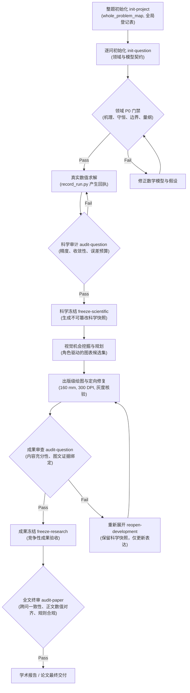

# ModelRigor

**科研级数学建模、可信计算与学术可视化 Skill**

[](https://github.com/2242756422-oss/modelrigor-math-modeling-skill/actions/workflows/ci.yml)
[](CHANGELOG.md)
[](LICENSE)
[](https://www.python.org/)

> **从数学机理推导到可信数值计算与学术出版级图表。**

[English Documentation](README.md)

---

## 项目背景与定位

在当前 AI 辅助数学建模与科研计算实践中，常见以下典型问题：
- **数值虚构与幻觉指标**：直接在报告中给出未经真实代码运行的参数估计、收敛阶或基线比较结果。
- **机理脱节与算法堆叠**：在未明确物理守恒定律、边界条件、变量量纲与假设前提的情况下，直接套用复杂的黑盒机器学习或元启发式算法。
- **论文主张不可追溯**：手稿中的核心数值与结论，无法对应到具体的运行版本、输入哈希与输出工件。
- **图表质量粗糙**：科研图表缺乏出版级尺寸规划（如 160 mm 满宽）、无色盲友好配色（Okabe-Ito）、缺乏灰度对比度检验或无真实数据绑定。

**ModelRigor** (`modelrigor`) 是一套面向科研级数学建模、可信数值实验与学术论文开发的成熟 Agent Skill 与 CLI 工具链。历经数十次版本迭代，该系统确立了**失败封闭（Fail-Closed）的质量门禁**、**密码级 SHA-256 证据溯源**、**双阶段冻结（Scientific Freeze / Research Freeze）状态机**以及**学术出版级可视化规范**。

---

## 核心差异与优势

| 维度 | 通用 AI 解题生成 | ModelRigor 体系 |
| :--- | :--- | :--- |
| **问题建模路线** | 直接堆叠流行算法与模板 | 领域机理优先，严密的方程与边界推导，Domain P0 门禁 |
| **数值真实性** | 仅生成文本数字，无法溯源 | SHA-256 执行回执，绑定 argv、输入输出与精确 Pointer |
| **成果生命周期** | 单一粗糙验收或手写 PASS | 双冻结机制：科学快照冻结与竞赛论文写作冻结彻底分离 |
| **误差与灵敏度** | 忽略或机械式扰动 | 真实的收敛阶检验、守恒量校验、参数可辨识性与不确定性预算 |
| **科研可视化** | 随机示意图、无尺寸标准 | 角色驱动（Mechanism/Diagnostic 等）、160 mm 满宽、有效 DPI 与灰度审查 |
| **跨问依赖协同** | 逐问割裂、上下文丢失 | 全局依赖图管理，上游科学变更自动触发下游 `STALE` 级联失效 |
| **协作资源开销** | 冗余的重复审查与全量重算 | `HIGH_QUALITY_EFFICIENT` 模式，6 个阶段工件按需构建，增量影响分析 |

---

## 系统架构

ModelRigor 采用声明式策略、模式约束、命令行执行器与领域协议协同的解耦架构：

```
modelrigor/
├── SKILL.md                          # Agent 入口与知识路由中枢
├── policy.json                       # 核心状态机、七大质量维度与规则定义
├── CHANGELOG.md                      # 完整版本演化与发布记录
├── LICENSE                           # MIT 开源许可证
├── agents/
│   └── openai.yaml                   # Agent 元数据与调用配置
├── scripts/
│   ├── cqex.py                       # 主调度 CLI（项目初始化、逐问审计、冻结、重开、依赖影响分析）
│   ├── core.py                       # 核心证据闭环、回执解析与终审校验引擎
│   ├── record_run.py                 # 带 SHA-256 快照的真实代码执行包装器
│   ├── register_result.py            # 类型化 Locator 数值结果注册器
│   ├── provenance.py                 # 来源性质分类（COMPUTED/ANALYTICAL/OBSERVED 等）与证据核验
│   ├── check_skill_integrity.py      # 安装包与语义回归完整性审计工具
│   ├── mine_visual_opportunities.py  # 依据模型与证据需求挖掘强视觉机会
│   └── visual_resource_smoke.py      # 可视化烟雾测试（支持平滑降级至原生 Matplotlib）
├── references/                       # 渐进披露的细化规范与方法库
│   ├── domain_and_model_protocol.md  # 领域专业性与数学模型协议
│   ├── scientific_evidence_protocol.md# 科学证据与回执规范
│   ├── visual_research_engine.md     # 科研图表挖掘与版面审查协议
│   ├── scientific_visualization_cookbook.md # 出版级科研图表配色与排版手册
│   ├── key_decision_only_protocol.md # 决策包协作协议（Stage A/Stage B）
│   └── whole_paper_audit.md          # 全文终审与跨问一致性核验
├── schemas/                          # 结构化工件与回执 JSON Schema
├── templates/                        # 可复用的规范化建模工件模板
├── examples/                         # 可完全复现的数值计算与出版绘图样例
└── tests/                            # 自动化测试套件（100 项 pytest + 39 项对抗探测）
```

### 建模全流程状态机



---

## 协作工作模式

1. **`FULL_RESEARCH`（全流程科研模式）**：
   从题意拆解、机理分析、方程建立、代码编写求解、灵敏度实验、论文撰写到全文终审的全闭环研发。
2. **`KEY_DECISION_ONLY`（关键决策包模式）**：
   在 Stage A 输出紧凑、可执行的 `QUESTION_DECISION_PACKET.md` 并暂停重型计算，将具体耗时求解或外部计算集群任务交付外部执行。
3. **`RETURN_AUDIT`（回执审计模式）**：
   接收外部执行结果（`EXECUTION_RETURN.md`），基于主风险进行 1–3 项代表性事实抽检与独立核验，严控外部结果质量。

---

## 环境要求

- **Python**：>= 3.10（已在 Python 3.10, 3.11, 3.12, 3.13 完成回归测试）
- **基础依赖**：
  ```bash
  pip install pytest numpy matplotlib pillow
  ```
- **操作系统**：macOS, Linux, Windows
- **支持环境**：Codex Skills 体系、Claude Code、Antigravity、OpenHands 以及本地命令行。

---

## 安装指南

### 方式 1：作为 Codex Skill 安装（直接 Clone）

将仓库直接克隆至 Codex 用户 Skill 目录：

```bash
git clone https://github.com/2242756422-oss/modelrigor-math-modeling-skill.git ~/.codex/skills/modelrigor
```

### 方式 2：作为独立开源项目使用

```bash
git clone https://github.com/2242756422-oss/modelrigor-math-modeling-skill.git
cd modelrigor-math-modeling-skill
pip install -r <(echo -e "pytest\nnumpy\nmatplotlib\npillow")
```

### 验证安装与包完整性

运行包完整性自检：

```bash
python scripts/check_skill_integrity.py . --scope package
```

运行自动化测试套件：

```bash
pytest tests/
```

两项命令均应输出 code 0（`OVERALL PACKAGE INTEGRITY PASS`，`100 passed`）。

---

## 快速上手教程

### 第一步：整题工作区初始化

```bash
python scripts/cqex.py init-project ./my_project --id math_opt_2026
```

该命令将创建全局状态文件与登记表（`project_state.json`、`whole_problem_map.json`、`page_budget.json`、`symbol_registry.json`、`figure_portfolio.csv` 等）。

### 第二步：子问题初始化（q1）

采用现代高效模式初始化问题子目录：

```bash
python scripts/cqex.py init-question ./my_project/q1 --id q1 --profile HIGH_QUALITY_EFFICIENT
```

### 第三步：激活领域专业检查（Domain P0）

针对具体物理系统或连续优化问题激活专业检查：

```bash
python scripts/cqex.py activate-domain ./my_project/q1 physical optimization
```

完善 `domain_model_map.json` 与 `model_contract.json`，确保守恒方程、约束条件、量纲单位及边界条件完备闭合。

### 第四步：求解与真实执行回执绑定

使用 `record_run.py` 包装真实算法求解脚本，记录 SHA-256 执行指纹：

```bash
python scripts/record_run.py \
  --root ./my_project/q1 \
  --code ./solvers/rk4_solver.py \
  --input ./data/params.json \
  --output ./results/output.json \
  --receipt ./results/receipt.json \
  -- python ./solvers/rk4_solver.py ./data/params.json ./results/output.json
```

将计算所得的关键数值登记至 Registry：

```bash
python scripts/register_result.py ./my_project/q1 \
  --id R1 \
  --meaning "steady_state_concentration" \
  --unit "mg/L" \
  --source-type computed \
  --artifact "results/output.json" \
  --pointer "/endpoint" \
  --scientific-version 1
```

### 第五步：科学快照冻结（Scientific Freeze）

```bash
python scripts/cqex.py audit-question ./my_project/q1 --phase scientific
python scripts/cqex.py freeze-scientific ./my_project/q1
```

冻结后将生成 `scientific_manifest.json`，固化科学结论。若后续修改了计算代码或输入，系统将通过依赖图自动标记下游依赖为 `STALE`。

### 第六步：学术图表开发与成果冻结（Research Freeze）

准备开发阶段工件：

```bash
python scripts/cqex.py prepare-stage ./my_project/q1 develop
```

按出版级规范生成并核验图表后，执行成果冻结：

```bash
python scripts/cqex.py audit-question ./my_project/q1 --phase research
python scripts/cqex.py freeze-research ./my_project/q1
```

---

## 内置可复现示例

项目在 [`examples/`](examples/) 提供了两个完全自主、数学严密的计算与绘图范例：

### 1. 常微分方程数值收敛性验证 (`linear_decay_validation.py`)
计算一级反应衰减 $\frac{dC}{dt} = -kC$，在 4 组网格步长下与解析解做严格比较：

```bash
python examples/linear_decay_validation.py solve /tmp/demo_ode
python examples/linear_decay_validation.py verify /tmp/demo_ode
python examples/linear_decay_plot.py /tmp/demo_ode
```
- **输出**：验证 4 阶 Runge-Kutta 的渐近收敛阶（$\sim 4.0$）与解析终点误差界（$1.22 \times 10^{-9}$）。
- 自动导出 160 mm 满宽的出版级 SVG 与 PNG 图表。

### 2. 守恒型动力系统双室交换 (`conservative_exchange.py`)
模拟严格质量守恒的双室浓度交换系统 $V \frac{dc}{dt} = (-Q(c_1-c_2), Q(c_1-c_2))$：

```bash
python examples/conservative_exchange.py --out /tmp/demo_exchange.json
python examples/conservative_exchange_plot.py /tmp/demo_exchange.json --out /tmp/demo_plots
```
- **输出**：验证系统质量守恒（$|\Delta M| < 10^{-15}$），对比显示隐式欧拉的无条件保正性，并进行参数可辨识性分析。

---

## 质量门禁体系

ModelRigor 确立了四道非阻断不可越过的质量门禁：

1. **领域专业性门禁（Domain P0 Gate）**：
   物理或数学机理必须进入变量表、控制方程、边界条件与失效分析；未通过 P0 审查不得进入生产求解。
2. **科学真实性门禁（Scientific Freeze Gate）**：
   必须具备闭合的模型契约、明确的假设账本、来源 Pointer 与工件哈希强绑定；不接受纯形式化自填的 PASS。
3. **成果完备性门禁（Research Freeze Gate）**：
   实质性审查论文内容展开度、图表角色覆盖率（图型适配而非数量充数）及图文数值一致性；若需文字重写，可执行 `reopen-development` 仅重开写作而不破坏科学快照。
4. **全文一致性终审（Whole-Paper Final Audit）**：
   运行 `cqex.py audit-paper`，通过 `sync_paper_numeric_map.py` 扫描正文全部数字标记与 Approved Result 映射，并审查跨问符号冲突与年度竞赛/期刊版式合规。

---

## 局限与边界声明

- **非自动定理证明器**：ModelRigor 确保模型结构闭合、代码运行真实、回执有效及误差受控，但无法替代人类专家对前沿全新数学命题的逻辑严密性判断。
- **不承诺学术录用或竞赛得奖**：ModelRigor 提供严谨的研究规范与科研级技术脚手架；成果的最终学术价值取决于研究团队的智力贡献与核心创新。
- **环境适配性**：全量 Word 逐页真实渲染审查（`--scope full`）依赖本机 LibreOffice/Word 渲染环境；包级完整性审计（`--scope package`）与 100 项核心单测原生跨平台免额外软件支持。

---

## 参与贡献

欢迎提交 Issue 与 Pull Request。贡献前请遵循：
1. 保持证据链失败封闭（Fail-Closed）特性；
2. 确保 `pytest tests/` 保持 100% 通过；
3. 确保 `python scripts/check_skill_integrity.py . --scope package` 通过；
4. 不得提交硬编码的本地私人绝对路径。

---

## 开源许可证

本项目基于 [MIT License](LICENSE) 开源。

Copyright (c) 2026 ModelRigor 贡献者 (`2242756422-oss`).
